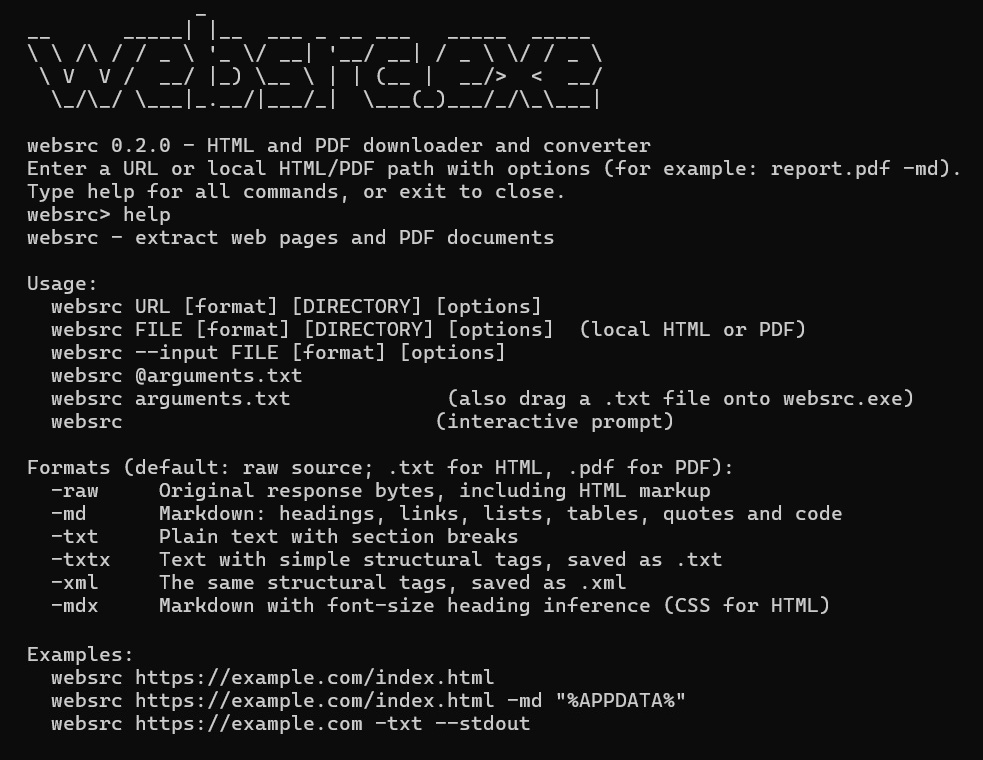
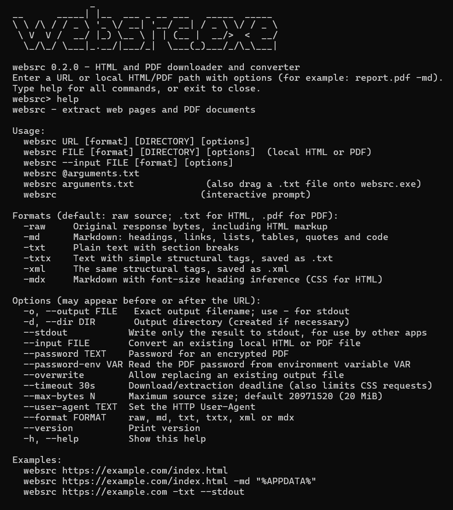

# Websrc - web parsing tool

A Windows CLI tool to parse webpages and PDFs into clean text, Markdown, or XML. Features optional hierarchy-aware layout prediction - useful for archiving, scraping, and LLM/MCP context. Dump locally or stream to stdout. Standalone tool, written in Golang.

Run and type help for more information

<a href="preview-sm.jpg" target="_blank">
  
</a>

## Build Windows x86 and x64

Requires Go 1.27.2 or later. Run from this folder in PowerShell:

```powershell
.\build.ps1
```

This builds both stripped, standalone executables with CGO disabled. To also produce compressed copies, install UPX separately and run:

```powershell
.\build.ps1 -Pack
# Or provide the path to UPX:
.\build.ps1 -Pack -UpxPath 'C:\Tools\upx.exe'
```

UPX 5.2.1 with `--best` compression was used for the supplied packed builds. The script checks each packed executable with `upx -t`. It can be called from any working directory and restores the environment variables it changes. Use `-Version` to override the default version `0.2.0`.

If PowerShell blocks script execution, use `powershell -NoProfile -ExecutionPolicy Bypass -File .\build.ps1 -Pack` (add `-UpxPath` if needed). The same invocation works for `verify.ps1`. This applies the execution policy only to that process.

```text
bin/
  unpacked/
    websrc-x86.exe
    websrc-x64.exe
  upx-packed/
    websrc-x86.exe
    websrc-x64.exe
```

## Verify

```powershell
go test ./...
go vet ./...
.\verify.ps1
```

Run verification on 64-bit Windows to execute both architectures. The script requires both unpacked binaries, checks any packed copies, and compares their HTML/PDF conversion output. It also checks executable architecture, the title banner, version and error handling. Verification creates temporary input files and removes them afterward.

## Use

```powershell
.\bin\unpacked\websrc-x64.exe
.\bin\unpacked\websrc-x64.exe https://example.com -md
.\bin\unpacked\websrc-x64.exe 'C:\Documents\report.pdf' -txt --stdout
.\bin\unpacked\websrc-x64.exe --help
```

With no arguments, the application opens an interactive prompt. Output formats are `-raw` (default), `-md`, `-txt`, `-txtx`, `-xml` and `-mdx`. Use `-o FILE` for an explicit destination or `--stdout` for another program to read the result. Default file output goes beside the executable. Existing files require `--overwrite` to replace.

### Output Formats
* `-raw` : Default dump format.
* `-md`  : Standard Markdown.
* `-mdx` : Markdown with predicted font-size hierarchy inference.
* `-txt` : Plain text.
* `-txtx`: Plain text with predicted hierarchy.
* `-xml` : Semantic XML-styled content.

### Routing & Storage
* `-o FILE`  : Specify an explicit destination path.
* `--stdout` : Stream content directly to terminal output for piping.

### Technical Notes
* HTML conversion uses static markup/CSS; JavaScript is not executed.
* PDF layout and font-size heading inference are heuristic.

Run `--help` for all options.

Dependencies are downloaded by Go during the first build. Third-party licenses and notices are in `third_party/`.


<a href="preview.jpg" target="_blank">
  
</a>
